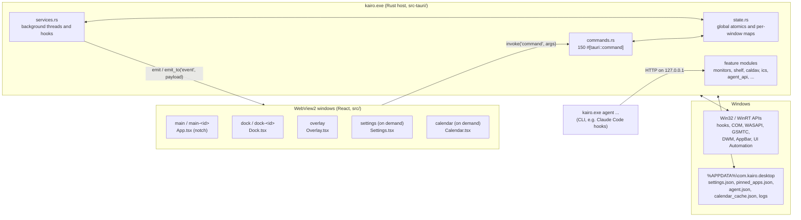
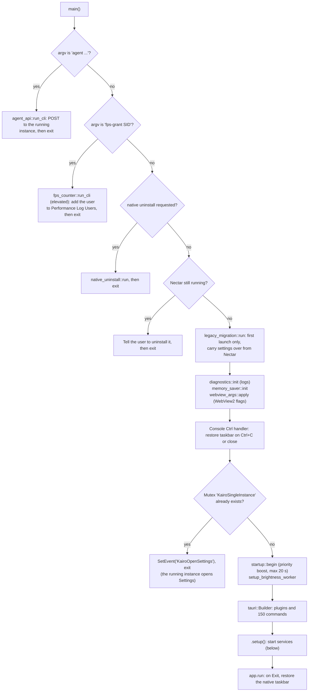
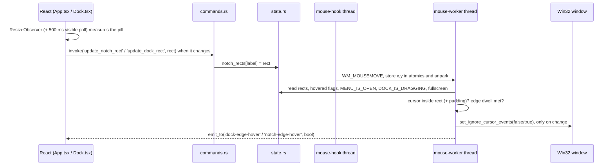
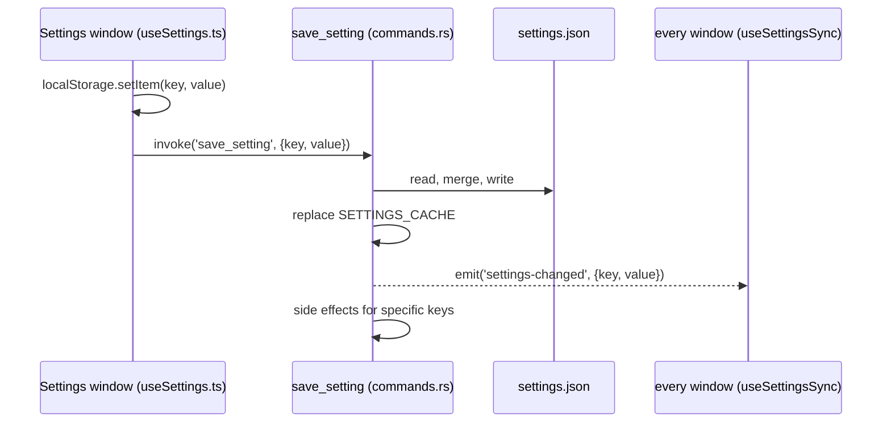

# Kairo architecture

Kairo is a Windows desktop shell add-on: a spring-animated **notch** at the top of the screen and a **dock** that replaces the Windows taskbar. It is a [Tauri 2](https://tauri.app) app. A Rust host (`kairo.exe`) does all the Windows work: hooks, COM, audio, the taskbar and window management. A set of transparent, always-on-top WebView2 windows draws the UI with React.

This document explains how the pieces fit together, where each responsibility lives, and the few non-obvious mechanisms you need to understand before changing anything.

> Version described: **1.9.1** (`package.json`, `src-tauri/Cargo.toml`, `src-tauri/tauri.conf.json`). Kairo is a fork of Nectar, renamed from it at that version.

---

## Contents

1. [The big picture](#1-the-big-picture)
2. [Repository layout](#2-repository-layout)
3. [Windows: one process, many webviews](#3-windows-one-process-many-webviews)
4. [Startup sequence](#4-startup-sequence)
5. [The Rust host](#5-the-rust-host)
6. [How the frontend talks to the host (IPC)](#6-how-the-frontend-talks-to-the-host-ipc)
7. [Key mechanism: click-through hit-testing](#7-key-mechanism-click-through-hit-testing)
8. [Key mechanism: replacing the taskbar and visibility modes](#8-key-mechanism-replacing-the-taskbar-and-visibility-modes)
9. [Settings and persistence](#9-settings-and-persistence)
10. [The React frontend](#10-the-react-frontend)
11. [End-to-end feature flows](#11-end-to-end-feature-flows)
12. [Performance design](#12-performance-design)
13. [Security boundaries](#13-security-boundaries)
14. [Build, release and distribution](#14-build-release-and-distribution)
15. [Common changes: where to start](#15-common-changes-where-to-start)

---

## 1. The big picture



The core idea:

- **The frontend draws, the host decides.** React components render the notch, dock and overlays. Anything that touches the OS, such as hit-testing, focus, volume, media, the taskbar or monitors, is done in Rust.
- **Two channels connect them.** The frontend calls Rust with **commands** (`invoke`). Rust pushes state to the frontend with **events** (`emit` / `emit_to`).
- **Every window is a separate web page.** Vite builds five HTML entry points, and each Tauri window loads one of them. Windows do not share JavaScript memory. They share state only through the host and `settings.json`.

---

## 2. Repository layout

| Path | What it is |
| --- | --- |
| [src-tauri/](src-tauri/) | The Rust host (the real app). Crate `kairo`, lib `kairo_lib`. |
| [src-tauri/src/main.rs](src-tauri/src/main.rs) | Entry point: CLI short-circuits, single-instance lock, Tauri builder, command registration, `setup()` that starts every background service, tray menu. |
| [src-tauri/tauri.conf.json](src-tauri/tauri.conf.json) | Eager windows, CSP, NSIS bundle. |
| [src-tauri/capabilities/default.json](src-tauri/capabilities/default.json) | Tauri permission set granted to all windows. |
| [src/](src/) | React + TypeScript frontend, one root component per window. |
| [index.html](index.html), [dock.html](dock.html), [overlay.html](overlay.html), [settings.html](settings.html), [calendar.html](calendar.html) | The five Vite entry points (see [vite.config.ts](vite.config.ts)). |
| [src/locales/](src/locales/) | UI strings (`en`, `tr`, `de`, `ar`, `es`, `fr`). |
| [public/](public/) | Static assets: mascot SVGs for the AI-agent status, notification sounds, logos. |
| [installer-app/](installer-app/) | A **second, separate Tauri app**: the custom first-install UI users download. See [§14](#14-build-release-and-distribution). |
| [installer/](installer/) | NSIS assets and hooks for the installer. |
| [scripts/](scripts/) | Version bumping, release helper, RAM benchmarking (`bench-ram.ps1`, `measure-ram.ps1`, `kairo-mem.ps1`). |
| [docs/](docs/) | Feature notes ([agents.md](docs/agents.md), [memory.md](docs/memory.md)) and images. |
| [SETTINGS.md](SETTINGS.md) | Reference for every `kairo-*` setting key. |
| [.github/workflows/release.yml](.github/workflows/release.yml) | Release pipeline. |

Size gives a sense of where the complexity is. Of about 31k lines of Rust/TS/TSX, the largest files are [services.rs](src-tauri/src/services.rs) (~3.9k), [commands.rs](src-tauri/src/commands.rs) (~4.3k), [App.tsx](src/App.tsx) (~3k) and [Dock.tsx](src/Dock.tsx) (~2.3k).

---

## 3. Windows: one process, many webviews

Each window is a WebView2 control hosted by `kairo.exe`, and each gets its own renderer and JS heap.

| Label | Page / React root | Created | Purpose |
| --- | --- | --- | --- |
| `main` | `index.html` → [App.tsx](src/App.tsx) | At launch (declared in `tauri.conf.json`) | The notch: music, Control Center, status, calendar, shelf, AI-agent status. |
| `dock` | `dock.html` → [Dock.tsx](src/Dock.tsx) | At launch | The taskbar replacement: pinned and running apps, previews, tray button. |
| `overlay` | `overlay.html` → [Overlay.tsx](src/Overlay.tsx) | At launch, shown once then hidden | Full-screen layer for the volume/brightness OSDs, the per-app volume mixer and output-device picker, and the startup splash. |
| `settings` | `settings.html` → [Settings.tsx](src/Settings.tsx) | **On demand** ([on_demand_windows.rs](src-tauri/src/on_demand_windows.rs)) | Settings UI with General, Appearance, Notch, Dock, Overlays, Processes, About and Calendar Sync tabs. |
| `calendar` | `calendar.html` → [Calendar.tsx](src/Calendar.tsx) | **On demand** | Full calendar window. |
| `main-<monitor>` / `dock-<monitor>` | same pages as `main` / `dock` | When **Show On** targets more than one monitor ([monitors.rs](src-tauri/src/monitors.rs)) | Per-monitor copies of the notch and dock. |

Important properties:

- **The notch, dock and overlay windows are large, transparent, undecorated, always on top, and skip the taskbar.** For example, the notch window is 1920×420 even though the visible notch is a small pill. What makes this work is [§7](#7-key-mechanism-click-through-hit-testing).
- **Labels carry meaning.** [state.rs](src-tauri/src/state.rs) has `is_notch_label` (`main` or `main-*`), `is_dock_label` (`dock` or `dock-*`) and `monitor_suffix`. Much of the per-window state is a `HashMap<label, T>` built by the `label_map!` macro.
- **On-demand windows are hidden on close, not destroyed.** Reopening is instant and unsaved edits survive. The host waits for the page to signal `on_demand_window_ready` (up to 2.5 s) before showing it, so it never flashes blank.

---

## 4. Startup sequence

All of this is in [main.rs](src-tauri/src/main.rs), in order:



`setup()` then, roughly in order:

1. Registers the notch hotkey thread ([hotkeys.rs](src-tauri/src/hotkeys.rs)).
2. **Crash recovery.** If a marker file says a previous run hid the taskbar and never restored it, restores it now ([utils.rs](src-tauri/src/utils.rs) `restore_taskbar_after_crash`).
3. Loads `settings.json` into the in-memory `SETTINGS_CACHE`.
4. Starts the agent HTTP API and calendar background sync.
5. Wires window events for `main` and `dock` and sets all three eager windows to ignore the cursor.
6. Syncs overlays and per-monitor windows.
7. Starts the hooks and workers: webview crash watcher, mouse hook, display-change monitor, window-change hook, attention (flashing) hook, thumbnail capture, Start Menu app scan, **system worker**, keyboard hook, taskbar hook, window-style guard, audio visualization, settings file watcher, memory reclaim worker.
8. Runs settings migrations on a background thread.
9. Listens for the second-instance event, which opens Settings.
10. Builds the tray icon and its menu (Calendar, Settings, Restart, Quit), with labels translated in Rust ([i18n.rs](src-tauri/src/i18n.rs)).

Every exit path restores the native taskbar: the Ctrl handler, `RunEvent::Exit`, tray Quit (`restore_taskbar_and_exit`), and the crash marker on the next launch. Restart sets `KAIRO_RESTARTING` so the next process does not mistake the restart for a crash.

---

## 5. The Rust host

### 5.1 Module map

| Area | Modules | Responsibility |
| --- | --- | --- |
| **Core plumbing** | [state.rs](src-tauri/src/state.rs), [types.rs](src-tauri/src/types.rs), [utils.rs](src-tauri/src/utils.rs) | Global state (atomics, `OnceLock`, per-label maps), shared structs (`AppInfo`, `MediaInfo`, `SystemCommand`, `MonitorInfo`), settings cache, taskbar show/hide, icon and thumbnail encoding, path resolution. |
| **Command surface** | [commands.rs](src-tauri/src/commands.rs) | Almost all `#[tauri::command]` handlers: dock and notch control, app launch and focus, media, volume, brightness, Wi-Fi/Bluetooth, settings I/O, shelf, diagnostics, quit/restart/uninstall. |
| **Background services** | [services.rs](src-tauri/src/services.rs) | Low-level keyboard and mouse hooks, WinEvent window-change hook, the system worker (audio endpoint and media sessions), DDC/CI brightness, audio visualization (WASAPI loopback + FFT), AppBar registration, display-change handling, Start Menu scan, webview crash recovery. |
| **Windows and monitors** | [monitors.rs](src-tauri/src/monitors.rs), [on_demand_windows.rs](src-tauri/src/on_demand_windows.rs) | Which monitor(s) get a notch and dock, per-monitor mode overrides, creating and destroying `main-*`/`dock-*` windows, lazy Settings and Calendar windows. |
| **Shell integration** | [taskbar_pins.rs](src-tauri/src/taskbar_pins.rs), [tray_icons.rs](src-tauri/src/tray_icons.rs), [attention.rs](src-tauri/src/attention.rs), [live_preview.rs](src-tauri/src/live_preview.rs), [capture.rs](src-tauri/src/capture.rs), [launchers.rs](src-tauri/src/launchers.rs), [hotkeys.rs](src-tauri/src/hotkeys.rs), [active_look.rs](src-tauri/src/active_look.rs) | Import the real taskbar pins (`User Pinned\TaskBar\*.lnk`), open the real tray flyout through UI Automation, detect flashing windows and unread counts (shell hook), DWM live thumbnails, launch apps, the global notch hotkey. |
| **System controls** | [audio_devices.rs](src-tauri/src/audio_devices.rs), [connections.rs](src-tauri/src/connections.rs) | Output device list and default device, Wi-Fi scan/connect/forget, Bluetooth devices, LAN status. |
| **Look and feel** | [windows_accent.rs](src-tauri/src/windows_accent.rs), [wallpaper.rs](src-tauri/src/wallpaper.rs) | Read and sync the Windows accent colour; wallpaper sampling for the glass backdrop. |
| **Features** | [shelf.rs](src-tauri/src/shelf.rs), [caldav.rs](src-tauri/src/caldav.rs), [calendar_sync.rs](src-tauri/src/calendar_sync.rs), [ics.rs](src-tauri/src/ics.rs), [agent_api.rs](src-tauri/src/agent_api.rs), [i18n.rs](src-tauri/src/i18n.rs) | File shelf (drop and drag out), CalDAV and ICS calendars (passwords in the Windows Credential Manager via `keyring`), AI agent status API, tray translations. |
| **Quick toggles** | [quick_toggles.rs](src-tauri/src/quick_toggles.rs) | Airplane mode (all radios off, since Windows has no public switch), microphone mute, mobile hotspot. |
| **Performance widgets** | [gpu_stats.rs](src-tauri/src/gpu_stats.rs), [fps_counter.rs](src-tauri/src/fps_counter.rs) | GPU usage (PDH `GPU Engine` counters, like Task Manager) and temperature (`D3DKMTQueryAdapterInfo`). Frame rate, frame time and 1% low of the foreground app from a real-time ETW session on the DXGI and D3D9 present events. Both start on demand and shut themselves down when idle. The ETW session needs the Performance Log Users group, granted once by `kairo.exe fps-grant <sid>` run elevated. |
| **Lifecycle** | [startup.rs](src-tauri/src/startup.rs), [legacy_migration.rs](src-tauri/src/legacy_migration.rs), [diagnostics.rs](src-tauri/src/diagnostics.rs), [memory_saver.rs](src-tauri/src/memory_saver.rs), [webview_args.rs](src-tauri/src/webview_args.rs), [uninstall_registry.rs](src-tauri/src/uninstall_registry.rs), [native_uninstall.rs](src-tauri/src/native_uninstall.rs) | Autostart (scheduled task), startup priority boost, carrying data over from Nectar on first launch, rotating log and diagnostics report, working-set trimming, WebView2 flags, uninstall registration and self-uninstall. |

### 5.2 Threading model

The host is mostly **plain OS threads plus lock-free shared state**, with Tokio (via `tauri::async_runtime`) for async I/O and debouncing.

| Thread / task | Where | How it runs |
| --- | --- | --- |
| `mouse-hook` | `services.rs` `start_mouse_hook_thread` | Installs `WH_MOUSE_LL` and pumps messages. The hook only stores the cursor position in atomics and unparks the worker, so it stays fast. |
| `mouse-worker` | `services.rs` `start_mouse_worker` | Parked until the cursor moves (or on a timer while an edge dwell is pending), throttled to about 32 ms. Runs the hit-test ([§7](#7-key-mechanism-click-through-hit-testing)). |
| System worker | `services.rs` `setup_system_worker` | Owns COM objects for the audio endpoint and the media session manager (GSMTC). Receives `SystemCommand`s over an `mpsc` channel and polls about every 200 ms idle, 64 ms for 2 s after activity. Emits `volume-change`, `media-update` and `media-sessions`. |
| Brightness worker | `services.rs` `setup_brightness_worker` | Serialises WMI and DDC/CI brightness writes from a channel. |
| Audio visualization | `services.rs` `setup_audio_visualization` | WASAPI loopback capture → `rustfft` → `audio-visualization` to notch windows only, at most 30 Hz. Runs only while wanted (music playing, setting on, microphone not blocked). |
| Window-change hook | `services.rs` `setup_window_change_hook` | `SetWinEventHook` for create/destroy/show/hide, debounced 200 ms → `windows-changed`. |
| Attention hook | `attention.rs` | Shell hook (`HSHELL_FLASH`, activate, redraw) → `app-attention`. |
| Hotkey thread | `hotkeys.rs` | `RegisterHotKey` message loop → `notch-hotkey-toggle`. Reloaded when the setting changes. |
| Settings watcher | `commands.rs` `setup_settings_watcher` | `ReadDirectoryChangesW` on the config dir. External edits → `settings-external-changed`. |
| Memory reclaim | `memory_saver.rs` | Trims the working set of the whole process tree when idle ([§12](#12-performance-design)). |
| Agent API server | `agent_api.rs` | Blocking `TcpListener` on `127.0.0.1`, at most 8 connections. |
| Async tasks | calendar sync, monitor sync, debounced emits | `tauri::async_runtime::spawn`. |

**Shared state** lives in [state.rs](src-tauri/src/state.rs):

- Global flags as atomics, such as `NATIVE_TASKBAR_HIDDEN`, `SHUTTING_DOWN`, `MENU_IS_OPEN`, `DOCK_IS_DRAGGING`, `CURRENT_FOREGROUND_FULLSCREEN` and `ANY_MEDIA_PLAYING`.
- Per-window maps keyed by label: `dock_rects`, `notch_rects`, `dock_hovered`, `notch_hidden`, `notch_fullscreen`, `dock_overlap`, `*_appbar_registered` and others. `clear_window_state(label)` drops them when a monitor window goes away.
- Caches: icons, installed apps, thumbnails, process names, settings.
- `COMMAND_SENDER`, the `Sender<SystemCommand>` that commands such as `media_play_pause` or `set_volume` use to reach the system worker.

`SHUTTING_DOWN` is set first on every quit or restart path. Window calls during webview teardown panic, so hooks and loops check this flag and stop.

---

## 6. How the frontend talks to the host (IPC)

### 6.1 Commands (frontend → host)

- Defined as `#[tauri::command]` functions, mostly in [commands.rs](src-tauri/src/commands.rs), some in feature modules (`connections::wifi_scan`, `startup::get_autostart`, `caldav::caldav_connect`, ...).
- **All 150 are registered in one place**, the `tauri::generate_handler![...]` list in [main.rs](src-tauri/src/main.rs). A command that is not listed there cannot be called.
- Called from TS with `invoke("snake_case_name", { camelCaseArgs })`. A command can take `window: Window` / `WebviewWindow` to know **which** window called it. This is how `update_notch_rect` or `get_dock_mode_for_window` work per monitor.

The heaviest callers are `App.tsx` (~67 `invoke` sites), `Dock.tsx` (~56), `settings/useSettings.ts` (~26) and `Overlay.tsx` (~21).

### 6.2 Events (host → frontend)

The host uses `app.emit(...)` to broadcast to every window and `app.emit_to(label, ...)` to target one. The main events:

| Event | Emitted by | Listened to in | Meaning |
| --- | --- | --- | --- |
| `settings-changed` | `save_setting`, import | `useSettingsSync`, `theme.ts` | A setting was written through the app. |
| `settings-external-changed` | settings watcher | `useSettingsSync`, `theme.ts` | `settings.json` was edited by hand. |
| `monitors-changed` | `monitors.rs` | App, Dock, Settings, theme | Displays were added, removed or rearranged. |
| `windows-changed` | WinEvent hook | Dock | Top-level windows opened or closed; refresh running apps. |
| `app-attention` | `attention.rs` | Dock | An app is flashing or its unread count changed. |
| `media-update`, `media-sessions` | system worker | App | Now playing (artwork only when it changes) and the list of sessions. |
| `audio-visualization` | audio capture | App (notch windows only) | FFT bars. |
| `volume-change`, `brightness-change` | system worker, brightness | App, Overlay | For the OSD and sliders. |
| `volume-edge-hover`, `brightness-edge-hover` | mouse worker | Overlay | Cursor at the screen edge that reveals those OSDs. |
| `dock-edge-hover`, `notch-edge-hover` | mouse worker | Dock, App | Reveal for Peek/Smart modes. |
| `dock-overlap`, `dock-maximized`, `dock-fullscreen`, `notch-overlap`, `notch-fullscreen` | window tracking | Dock, App | Drive Smart mode and hiding over fullscreen apps. |
| `dock-win-number` | keyboard hook | Dock | Win+1…9 launches the Nth dock app. |
| `notch-hotkey-toggle` | hotkeys | App | User hotkey toggles the notch. |
| `shelf-drag-enter` / `shelf-drag-leave` / `shelf-drag-drop` | shelf drop target | App, NotchShelf | Files dragged onto the notch. |
| `agent-activity`, `agent-sound-changed` | agent API | App, settings | AI agent state and permission prompts. |
| `caldav-updated` | calendar sync | `useCaldav` | New calendar data in the cache. |
| `system-accent-changed`, `icon-cache-cleared` | accent, icon cache | theme, Dock | Re-theme; reload icons. |

Windows also talk to **each other** through frontend `emit` (for example `settings-navigate`, `start-tour` and `splash-done`), relayed by Tauri's event bus.

---

## 7. Key mechanism: click-through hit-testing

**Problem:** the notch and dock windows are much larger than what you see, and they sit on top of everything. If they accepted clicks everywhere, they would block the apps underneath.

**Solution:** each window ignores the cursor by default, and the host turns input on only while the cursor is over the visible UI.



Details worth knowing:

- The decision is cached (`MH_LAST_*_IGNORE`), so the OS call happens only on transitions.
- The window stays interactive while a menu is open (`set_menu_open`) or while the dock is being dragged (`set_dock_dragging`), even if the cursor leaves the pill.
- The window is forced click-through when a fullscreen app is in front, when the Start or Search shell surface is focused, or when a screen-capture UI is active.
- The same worker handles **edge reveal** (Peek mode): the cursor must rest in the edge band for a configurable dwell time (`edge_dwell_met`, `top_edge_armed`).
- Extra monitors run the same logic for their own windows (`hit_test_extra_dock_windows` / `hit_test_extra_notch_windows`).
- Settings › About can turn on hit-box logging (`set_hitbox_logging`), which writes each decision to `kairo.log`. This is the first tool to use when clicks "fall through" or "get stuck".

---

## 8. Key mechanism: replacing the taskbar and visibility modes

- **Hiding the real taskbar.** `set_taskbar_visibility` in [utils.rs](src-tauri/src/utils.rs) hides the primary and secondary taskbars, records the original state in a **marker file**, and restores it on every exit path ([§4](#4-startup-sequence)). The frontend calls `init_dock` after the splash, which is when the taskbar is actually hidden.
- **Visibility modes** (set separately for notch and dock, optionally per monitor via `kairo-*-mode-by-monitor`):
  - **Fixed.** The window is registered as a Win32 **AppBar** (`register_appbar` / `register_dock_appbar` in `services.rs`), so maximized windows leave room for it, like the real taskbar.
  - **Smart.** Hides when another window overlaps it (`dock-overlap` / `notch-overlap`) and reveals on hover.
  - **Peek.** Hidden until the cursor reaches the edge (`*-edge-hover`) or a media event arrives.
  - In Smart and Peek, both stay hidden and click-through while a fullscreen window covers their monitor.
- Mode changes go through `change_dock_mode` / `change_notch_mode`, which register or unregister the AppBar and reposition the window.
- **Display changes** (resolution, DPI, monitors plugged in or out) are handled by `setup_display_change_monitor`, which repositions every window and re-syncs the per-monitor windows.
- **Native integration:** the dock's tray button opens the **real** Windows tray flyout through UI Automation ([tray_icons.rs](src-tauri/src/tray_icons.rs)). Quit uses `end_task`, like Task Manager's End task. Pinned apps are imported from the real taskbar pin folder ([taskbar_pins.rs](src-tauri/src/taskbar_pins.rs)).

---

## 9. Settings and persistence

### 9.1 Where data lives

Everything is in `%APPDATA%\com.kairo.desktop\` (Tauri's `app_config_dir`):

| File | Contents |
| --- | --- |
| `settings.json` | A flat JSON map of `kairo-*` keys to values. This is the source of truth for settings, documented in [SETTINGS.md](SETTINGS.md). |
| `pinned_apps.json` | The dock's pinned apps. |
| `agent.json` | Port and random token for the local agent API. |
| `calendar_cache.json` | Synced calendar events (35 days back to 95 days ahead). |
| `logs/kairo.log`, `diagnostics.txt` | Rotating log (1 MB cap) and the **Copy Diagnostics** report. |
| Windows Credential Manager | CalDAV passwords (via the `keyring` crate), never in a file. |

Each webview also keeps a copy of settings in its own `localStorage`. This copy lets a window render with the right values on its first frame, before any IPC. The file is still the authority.

### 9.2 Write path



Some keys trigger **side effects in Rust** inside `save_setting`:

- `kairo-scale` re-registers the AppBars.
- `kairo-agent-api` installs or removes the Claude Code hooks.
- `kairo-notch-hotkey` reloads the global hotkey.
- `kairo-language` re-translates the tray menu.
- Any monitor-targeting key re-syncs the per-monitor windows and re-applies the modes.

Rust code reads settings with `get_setting_str(app, key)`, which hits the in-memory cache, not the disk. Two exceptions read the file directly before Tauri exists: `webview_args.rs` (for `kairo-ram-ultra`) and the startup path.

**Hand edits** to `settings.json` are picked up by the directory watcher, which emits `settings-external-changed`. [useSettingsSync.ts](src/hooks/useSettingsSync.ts) mirrors the new value into `localStorage` and calls the matching handler. Values may arrive as `"true"`/`"false"`/numeric strings, and the hook converts them.

---

## 10. The React frontend

### 10.1 Stack

React 19, TypeScript, Vite 7 (multi-page build), **framer-motion** for the spring animations, **@dnd-kit** for drag-to-reorder (dock items, panel order, Control Center layout), **lucide-react** and SVGR-imported SF-style icons ([src/icons/](src/icons/)). Styling is plain CSS per window (`App.css`, `Dock.css`, `Overlay.css`, `Settings.css`, `surfaces.css`). Tailwind is listed in `devDependencies` but not used.

### 10.2 Per-window roots

- **[App.tsx](src/App.tsx), the notch.** One large component that owns the notch's state machine: compact/expanded, the active panel, media, the agent state, the tour. Panels and their default order come from [panelOrder.ts](src/panelOrder.ts): `command-center`, `status`, `music`, `calendar`, `shelf`. Panel content lives in [src/components/](src/components/):
  - `ConnectionsView` (Wi-Fi and Bluetooth)
  - `NotchCalendar`, `NotchClock`, `DualClockPicker`
  - `NotchShelf`
  - `AgentStatus` (mascot, dot and permission panel)
  - `NotchTour` (first-run tour)
  - `SurfaceShape`, `NotchProgressBorder` (timer progress)
  - [CompactMediaPlayer.tsx](src/CompactMediaPlayer.tsx), with colours taken from album art ([music/palette.ts](src/music/palette.ts))
- **[Dock.tsx](src/Dock.tsx).** Merges pinned apps (`load_pinned_apps`) with running windows (`get_active_windows`). It refreshes on `windows-changed` plus a 10 s visible-only poll, and keeps the array identity when nothing changed so effects don't restart. It also handles attention dots, thumbnails and live previews, context menus, Win+N launching, drag and drop, and Smart/Peek reveal.
- **[Overlay.tsx](src/Overlay.tsx).** The volume and brightness OSDs that replace the native flyout (the host hides the native `NativeHWNDHost` OSD when an overlay is enabled), the per-app **volume mixer** and output-device picker, the update toast, and the splash.
- **[Settings.tsx](src/Settings.tsx).** A tab shell over [src/settings/](src/settings/). State is centralised in [useSettings.ts](src/settings/useSettings.ts), which reads `localStorage`, writes through `save_setting`, and listens for sync events.
- **[Calendar.tsx](src/Calendar.tsx).** Day, week, month and agenda views over local events plus the CalDAV/ICS cache.

### 10.3 Shared frontend modules

| Module | Role |
| --- | --- |
| [theme.ts](src/theme.ts), [backdrop.ts](src/backdrop.ts) | Theme presets, surface styles (`solid`, `frosted`, `liquid`, `material`), accent colour (including Windows accent sync), wallpaper-based glass backdrop. Every window calls `initTheme()` and re-themes on settings, accent and monitor events. |
| [i18n.ts](src/i18n.ts) | `useT()` / `t()`. English is bundled and other languages are lazy-loaded JSON, falling back to English per key. RTL is applied only to the Settings and Calendar pages. |
| [hooks/visibleInterval.ts](src/hooks/visibleInterval.ts) | A `setInterval` that does not run while the window is hidden. Use it for every poll. |
| [hooks/useSettingsSync.ts](src/hooks/useSettingsSync.ts) | Subscribe to setting changes by key. |
| [hooks/useWeather.ts](src/hooks/useWeather.ts) | Open-Meteo weather with IP-based geolocation fallbacks (the CSP allows exactly these hosts). |
| [hooks/useCaldav.ts](src/hooks/useCaldav.ts), `useStopwatch`, `useTrailingThrottle` | Calendar cache, stopwatch, throttling. |
| [agentSounds.ts](src/agentSounds.ts), [attention.ts](src/attention.ts), [clockFormat.ts](src/clockFormat.ts), [dualClock.ts](src/dualClock.ts) | Small single-purpose helpers. |

---

## 11. End-to-end feature flows

**Media playback (notch Music panel).**
The system worker polls the WinRT `GlobalSystemMediaTransportControlsSessionManager` and emits `media-update` (title, artist, position, base64 artwork only when it changes) and `media-sessions`. The notch renders it. Pressing play calls `invoke('media_play_pause')`, which sends `SystemCommand::MediaPlayPause` over `COMMAND_SENDER` to the same worker, so all COM work stays on one thread.

**Volume key → OSD.**
The low-level keyboard hook intercepts volume and brightness keys and forwards them to the system or brightness worker. The worker emits `volume-change` / `brightness-change`. The overlay shows Kairo's OSD and the host hides the native one.

**Dock app list.**
On start, the dock asks for pinned apps (imported from the real taskbar the first time) and running windows. Each WinEvent window create/destroy (debounced 200 ms) emits `windows-changed`, and the dock re-queries. Flashing windows arrive as `app-attention`. Icons are extracted in Rust and cached as base64.

**AI agent status ([docs/agents.md](docs/agents.md)).**
1. When `kairo-agent-api` is on, the host listens on a random loopback port and writes the port and token to `agent.json`. It also adds hooks to `~/.claude/settings.json`, keeping a backup.
2. Claude Code's hooks run `kairo.exe agent working|needs-input|done|...`. `main()` sees the `agent` argument, reads `agent.json`, POSTs to the running instance and exits, without ever starting the UI.
3. The server emits `agent-activity` and the notch shows the mascot and dot.
4. A permission question blocks the HTTP request for up to 120 s until the user clicks Allow or Deny (`agent_answer`). Otherwise Claude Code falls back to asking in the terminal.

**Calendar sync.**
`calendar_sync::start_background_sync` refreshes CalDAV accounts and ICS links every 15 minutes (minimum 5), and right away after a crash or restart. It writes `calendar_cache.json` and emits `caldav-updated`.

**Updates.**
Kairo has no update system and makes no update checks. A new version is installed by running a newer installer over it.

---

## 12. Performance design

Kairo is always on, so its footprint is treated as a feature. [docs/memory.md](docs/memory.md) has the measurements: about 95% less idle private working set than before these changes. The main mechanisms are:

- **Fewer renderers.** Only the notch, dock and overlay exist at launch. Settings and Calendar are built on demand and asked for `MEMORY_USAGE_TARGET_LEVEL_LOW` when hidden.
- **WebView2 flags** ([webview_args.rs](src-tauri/src/webview_args.rs)), set through `WEBVIEW2_ADDITIONAL_BROWSER_ARGUMENTS` before the first window: no spare renderer, no background networking, small caches, low-end device mode, one renderer process. `--disable-gpu` is only added with the opt-in `kairo-ram-ultra`.
- **Working-set trimming** ([memory_saver.rs](src-tauri/src/memory_saver.rs)). After about 3 s of idle, it calls `EmptyWorkingSet` on the host and all WebView2 child processes, and repeats every couple of seconds while idle (15 s while media plays). It never trims during menus, drags or the splash.
- **Block instead of poll.** The system worker waits on its command channel with a timeout. The mouse worker is parked until the hook unparks it. Window changes are event-driven and debounced.
- **Frontend discipline.** Visibility-gated intervals, one batched `get_system_metrics` call instead of four, rect updates only on change, artwork sent only when it changes, visualizer only to notch windows at ≤30 Hz.

> Note: `docs/memory.md` uses older file names. `lazy_windows.rs` is now **`on_demand_windows.rs`**, `webview_tuning.rs` is **`webview_args.rs`**, and `mem.rs` is **`memory_saver.rs`**.

---

## 13. Security boundaries

- **CSP** (in `tauri.conf.json`): scripts only from the app itself. Network access only to IPC, Open-Meteo, and four IP-geolocation services. Images only from `self`, `data:` and `blob:`.
- **Capabilities** ([default.json](src-tauri/capabilities/default.json)): the core window and event permissions plus the opener, autostart, dialog and drag plugins. Everything else goes through Kairo's own commands.
- **Agent API**: bound to `127.0.0.1` only, random port, random token stored in `agent.json`, request size and connection limits, input sanitised (`clean`).
- **Credentials**: CalDAV passwords live in the Windows Credential Manager.
- **No telemetry.** The only outbound calls are weather, geolocation and user-configured calendars.

---

## 14. Build, release and distribution

**Development**

```bash
npm install
npm run tauri dev        # Vite on :1420 + the Rust host
npx tsc --noEmit         # type-check the frontend
cd src-tauri && cargo test --bin kairo
```

A plain `cargo build --release` produces a **dev-mode** binary that points at `localhost:1420`. Build a real binary with `npm run tauri build`, or with `cargo build --release --features tauri/custom-protocol`. Many behaviours (the dock, taskbar, tray flyout) differ between dev and release, so test on a release build.

**Release** ([release.yml](.github/workflows/release.yml), run manually on a `vX.Y.Z` tag):

1. Checks that the version matches across **six** files: `package.json`, `tauri.conf.json` and `Cargo.toml` for both the main app and `installer-app`. Use `npm run bump <version>` ([scripts/bump-version.mjs](scripts/bump-version.mjs)) before tagging.
2. Builds the main app and its NSIS installer.
3. Builds the **custom installer** ([installer-app/](installer-app/), see its README), a separate Tauri app that embeds the main exe as a zipped payload (`include_bytes!`). It installs per-user or all-users (self-elevating), creates shortcuts, registers an uninstaller, and doubles as `uninstall.exe --uninstall`.
4. Publishes `SHA256SUMS.txt` for verification.

There are two installers because the custom one in `installer-app/` is an alternative with its own UI. `npm run tauri build` only makes the NSIS one.

---

## 15. Common changes: where to start

| You want to… | Do this |
| --- | --- |
| **Add a backend capability** | Write a `#[tauri::command]` fn (in `commands.rs` or a new module declared in `main.rs`), **add it to `generate_handler!` in `main.rs`**, then `invoke("name", {...})` from TS. |
| **Push live data to the UI** | Produce it on an existing worker thread (or a new one started in `setup()`), `emit` / `emit_to` an event, and `listen` in the component. Gate it on whether anyone needs it. |
| **Add a setting** | Choose a `kairo-*` key, read and write it in [useSettings.ts](src/settings/useSettings.ts) (UI) and/or `get_setting_str` (Rust), subscribe with `useSettingsSync` in the windows that care, and **document it in [SETTINGS.md](SETTINGS.md)**. If Rust must react immediately, add a branch in `save_setting`. |
| **Add a notch panel** | Add its id to `DEFAULT_PANEL_ORDER` in [panelOrder.ts](src/panelOrder.ts), build the component under `src/components/`, render it in `App.tsx`, and add the order/toggle in `NotchTab.tsx`. |
| **Add a language** | Add `src/locales/<code>.json`, list it in `LANGUAGES` and `LAZY_LOCALES` in [i18n.ts](src/i18n.ts), and add it to `LOCALES` in [i18n.rs](src-tauri/src/i18n.rs) for the tray. |
| **Debug "clicks go through" or "the dock won't hide"** | Turn on hit-box logging in Settings › About and read `logs/kairo.log`; the logic is in `process_mouse_move` in `services.rs`. |
| **Debug memory or CPU** | `scripts/bench-ram.ps1 -Detail` on a release build; see [docs/memory.md](docs/memory.md). |

Kairo is a modified fork of [Nectar](https://github.com/kua8/Nectar) by kua8, itself a fork of [Bloom](https://github.com/SehajveerSingh2005/bloom), and is licensed under GPLv3 ([LICENSE](LICENSE)).
