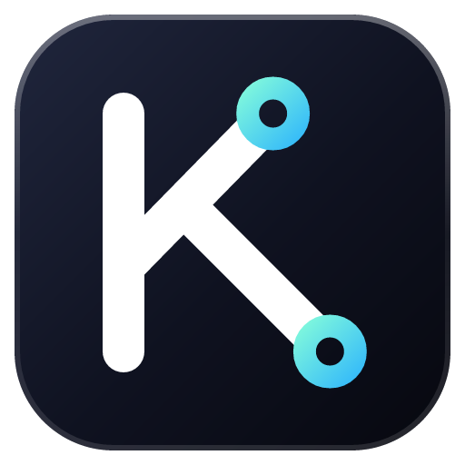

<div align="center">



<br />

<picture>
  <source media="(prefers-color-scheme: dark)" srcset="docs/wordmark-dark.png" />
  
</picture>

<p><strong>A notch and a dock for Windows.<br />Physics-animated, reactive, and built to replace your taskbar.</strong></p>

[Features](#features) &nbsp;·&nbsp; [Install](#install) &nbsp;·&nbsp; [Settings](SETTINGS.md) &nbsp;·&nbsp; [Architecture](ARCHITECTURE.md) &nbsp;·&nbsp; [Report a bug](https://github.com/nitinrawatisMLeng/kairo/issues/new/choose)

</div>

<br />

> Kairo is a modified fork of [Nectar](https://github.com/kua8/Nectar) by kua8, renamed and changed from Nectar 1.9.1 in November 2026. See [Credits](#credits).

## Features

| What you get | How |
| --- | --- |
| **A notch that does things** | Music, a Control Center you arrange yourself, status, a calendar and a file shelf in one spring-animated island. |
| **A dock that replaces your taskbar** | Mirrors your real taskbar, same pinned apps and order, with real icons and names, and a dot on apps that want your attention. Round or rounded-square icons. |
| **Performance at a glance** | CPU, GPU usage and temperature, RAM in percent or GB, disk, network, and the frame rate, frame time and 1% low of the game in front. |
| **Quick settings** | Wi-Fi and Bluetooth with the connected network and device named on their tiles, airplane mode, microphone mute, mobile hotspot, Do Not Disturb, volume and brightness. |
| **Native where it counts** | The tray opens the real Windows flyout, and Quit ends an app like Task Manager's End task. |
| **Out of your way** | Fixed, Smart or Peek modes, and both stay hidden over fullscreen games. |
| **Made for your setup** | Every monitor, one monitor, or a specific one. Solid, frosted, liquid, fluid or Material You styles with your own accent color. Six languages. Every option lives in a plain `settings.json`. |
| **Light on the system** | Audio capture, cursor tracking and thumbnail work pause themselves when nothing needs them. |

## Install

1. Build the installer ([below](#build-from-source)), or get it from the [releases page](https://github.com/nitinrawatisMLeng/kairo/releases) if one is published.
2. Run `Kairo_<version>_x64-setup.exe` and choose **Just me** or **All users**. An all-users install asks for administrator permission once. Windows SmartScreen warns about it because it isn't code-signed: choose **More info**, then **Run anyway**.
3. Kairo starts with a short splash, then the notch and dock appear together.

Kairo doesn't check for updates or contact anyone about them. To update, run a newer installer over it. **Uninstall** from Windows Settings › Apps or from **Settings › About**; either puts your taskbar back.

**Coming from Nectar?** Uninstall Nectar first, since the two can't run side by side. Kairo carries over your settings, pinned apps, custom icons and Start at login the first time it opens.

## Usage

**Notch panels.** Scroll or swipe on the notch to change panel.

| Panel | What it does |
| --- | --- |
| **Music** | Album art, track info, playback controls, a visualizer, and a switch between several playing apps. |
| **Control Center** | Wi-Fi, Bluetooth, airplane mode, microphone, hotspot, Do Not Disturb, volume and brightness. Drag tiles, buttons and sliders into your own layout. |
| **Status** | Battery, weather and performance widgets, in a layout you choose. |
| **Calendar** | Day, week, month and agenda views, a timer, a stopwatch and Pomodoro. |
| **Shelf** | Drop files or text on the notch and drag them out later. |

**Visibility modes.** The notch and the dock each have their own.

| Mode | Behavior |
| --- | --- |
| **Fixed** | Always visible. The dock reserves screen space like a normal taskbar. |
| **Smart** | Hides when another window overlaps it and reveals on hover. |
| **Peek** | Hidden until the cursor reaches the screen edge, or a media event arrives. |

In Smart and Peek both stay hidden, and click-through, while a fullscreen app is in front.

**Multiple monitors.** Under **Show On**, pick **Primary Monitor** (the default), **All Monitors** or a **Specific Monitor** for the dock and the notch separately. Each extra monitor gets its own windows, so **All Monitors** uses more memory than a single display.

## Troubleshooting

<details>
<summary><b>The Wi-Fi list only shows my current network</b></summary>

<br />

Since Windows 11 24H2, Windows only lists nearby networks to apps while Location is on. The list has a button that opens that setting. Your current network shows either way.

</details>

<details>
<summary><b>The FPS widget shows a dash</b></summary>

<br />

Turn on the counter once in **Settings › Notch › Widgets › FPS counter**, then sign out of Windows and back in. It counts the app in front, for Direct3D 9 to 12 games.

</details>

<details>
<summary><b>The dock shows over my game</b></summary>

<br />

Kairo hides the dock and notch over a fullscreen window that covers the whole monitor, in Smart and Peek. Fixed mode stays visible by design.

</details>

<details>
<summary><b>The Windows taskbar did not come back</b></summary>

<br />

Start Kairo again, it restores the taskbar on launch even after a crash. Uninstalling from Windows Settings › Apps or from **Settings › About** brings it back too.

</details>

<details>
<summary><b>Kairo uses a lot of memory</b></summary>

<br />

Every window runs in its own WebView2 process, so each monitor adds a notch and a dock. Set **Show On** to one monitor to cut it down.

</details>

<details>
<summary><b>Brightness does not change on my external monitor</b></summary>

<br />

External monitors are controlled over DDC/CI. Turn DDC/CI on in the monitor's own menu, and connect it directly if you use a dock or adapter, since some do not pass it on.

</details>

<details>
<summary><b>Something else is broken</b></summary>

<br />

Open **Settings › About › Copy Diagnostics** and paste the result into a [bug report](https://github.com/nitinrawatisMLeng/kairo/issues/new/choose). It includes your versions, monitors and recent log.

</details>

## Build from source

You need [Rust](https://rustup.rs/), [Node.js](https://nodejs.org/) and the Visual Studio C++ build tools, on Windows.

```bash
git clone https://github.com/nitinrawatisMLeng/kairo.git
cd Kairo
npm install
npm run tauri dev
```

`npm run tauri build` makes a release build. The installer lands in `src-tauri/target/release/bundle/nsis/`. Read [ARCHITECTURE.md](ARCHITECTURE.md) for how it fits together, and [CONTRIBUTING.md](CONTRIBUTING.md) before a pull request.

## License

Kairo is open source under the [GPLv3](LICENSE), the same license as the projects it comes from.

## Credits

Kairo is a modified fork of [Nectar](https://github.com/kua8/Nectar) by kua8, which began as a fork of [Bloom](https://github.com/SehajveerSingh2005/bloom) by Sehajveer Singh. The original concept and the codebase it grew from are theirs.
